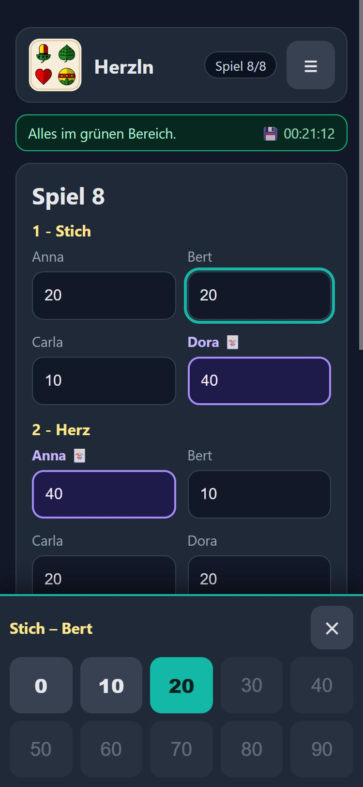
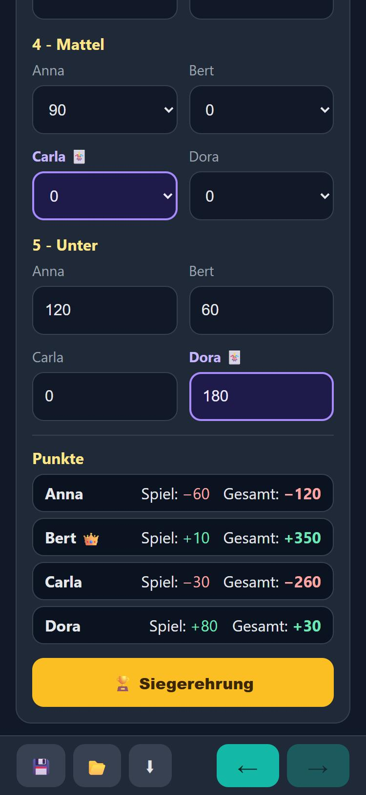
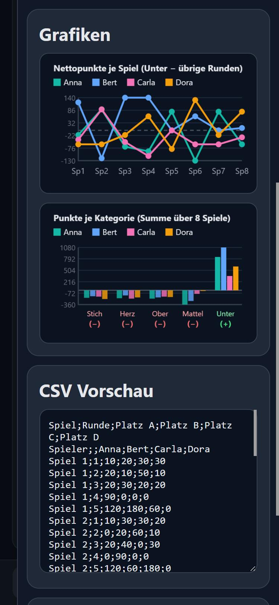
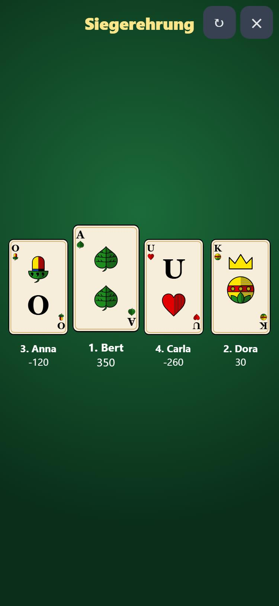
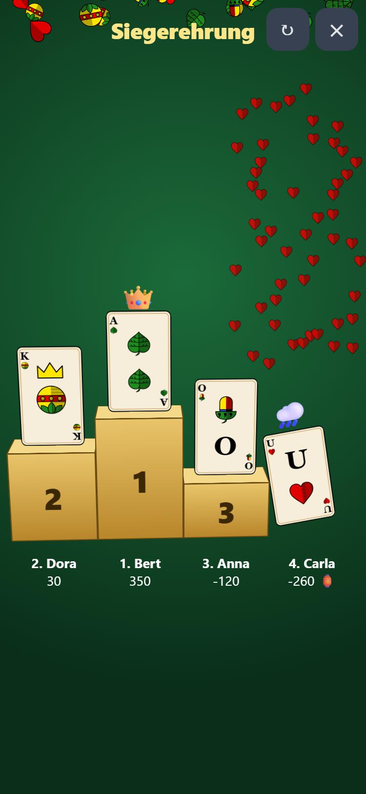

# Herzln Offline

Punkteblock für Herzln – 4 Spieler, 8 Spiele à 5 Runden (Stich, Herz, Ober, Mattel, Unter).

- Installierbar als App (PWA), funktioniert offline
- Geber wählbar, wechselt jede Runde reihum und ist bei der Eingabe markiert
- Zahlen-Tippfeld statt Tastatur; unplausible Werte werden abgedunkelt, bleiben aber zur Korrektur wählbar
- Nächstes Spiel erst, wenn keine Runde mehr leer ist
- Punkte je Spiel und gesamt, Grafiken, Siegerehrung nach Spiel 8
- Automatisches Speichern im Browser, Export als JSON/CSV
- Spielernamen werden einmal pro Gerät eingegeben und dort gemerkt (keine Namen im Code)
- Bildschirm bleibt während des Spiels an (im Menü abschaltbar)

**Live:** https://gitlgn.github.io/herzln/

## Ansichten

*Beispiele mit Fantasienamen.*

| Eingabe mit Tippfeld | Punkte am Spielende | Grafiken |
|:---:|:---:|:---:|
|  |  |  |

| Siegerehrung: Aufdecken | Siegerehrung: Treppchen |
|:---:|:---:|
|  |  |
